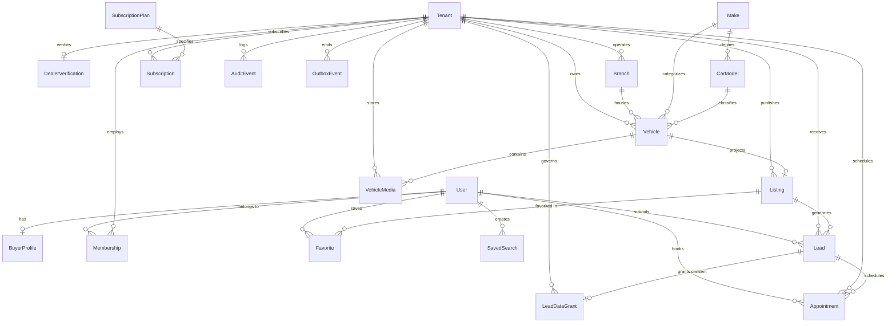

# Automotive OS — Production Database Design & Audit

**Date:** 2026-10-20  
**Phase:** Database Design & Multi-Tenancy Architecture (Sprint 0 / Pre-Migration)  
**Status:** DRAFT PROPOSAL — MIGRATIONS NOT APPLIED (Pending Approval)

---

## 1. Audit of Draft Starter Schema (`db_starter/schema.prisma`)

A rigorous audit of the reference draft schema ([`docs/references/db_starter/schema.prisma`](file:///H:/Personal/Automotiv%20OS/docs/references/db_starter/schema.prisma)) and starter RLS script ([`docs/references/db_starter/tenant_policies.sql`](file:///H:/Personal/Automotiv%20OS/docs/references/db_starter/tenant_policies.sql)) identified several structural and security vulnerabilities that had to be addressed before production migration:

| Area | Draft Schema Defect / Gap | Production Hardening Applied |
| :--- | :--- | :--- |
| **Composite Tenant FKs** | `Appointment`, `Subscription`, and `LeadDataGrant` lacked `@@unique([tenantId, id])`, leaving them vulnerable to cross-tenant orphan injection. | Added `@@unique([tenantId, id])` to all tenant-owned operational models. Added `@@unique([tenantId, leadId])` on `LeadDataGrant` to prevent cross-tenant grant linking. |
| **Lead Intent Integrity** | `intent` was stored as an unvalidated raw `String` in `Lead`. | Introduced strongly-typed `LeadIntent` enum (`ENQUIRY`, `TEST_DRIVE`, `OFFER`). |
| **Buyer Resource RLS** | `tenant_policies.sql` only isolated dealer operational tables by `tenant_id`. Global buyer resources (`buyer_profiles`, `favorites`, `saved_searches`) had **zero RLS policies**, creating a major authorization risk. | Introduced `app.current_user_uuid()` and implemented `buyer_isolation` policies ensuring buyers can only query their own data. |
| **Public Listing Projection** | Private vehicle columns (`purchaseCostFils`, private VIN) sat directly beside public attributes with no public read policy or database-level projection boundaries. | Added public read RLS policy on `listings` gated strictly by `status = 'PUBLISHED'` and `vehicle_media` by `is_public = true`. |
| **Outbox Indexing & Association** | `OutboxEvent` lacked a `tenantId` index, making multi-tenant queue partitioning or tenant event replays inefficient. | Added `tenantId` foreign key and composite index `@@index([tenantId, occurredAt])`. |
| **Timestamp Completeness** | Several models lacked explicit `createdAt` and `updatedAt` tracking (`Branch`, `DealerVerification`, `SavedSearch`, `SubscriptionPlan`, `VehicleMedia`). | Added UTC `createdAt` and `updatedAt` timestamps across all persistent models. |

---

## 2. Production MVP Entity-Relationship Diagram (ERD)



---

## 3. Domain Model Specifications

### 3.1 Global Identity & Buyer Domain
- **`User`**: Global user identity across the UAE marketplace. External identity mapped via OIDC `identitySubject`. Flag `isPlatformAdmin` strictly identifies platform moderators and auditors.
- **`BuyerProfile`**: Private buyer preferences, language (`en` / `ar`), UAE emirate preference, and budget bounds (`budgetMinFils`, `budgetMaxFils`).
- **`Favorite` & `SavedSearch`**: Buyer-curated vehicles and JSON-serialized filter criteria with automated search alert toggles.

### 3.2 Tenancy, KYB & Roles
- **`Tenant`**: Licensed UAE dealership tenant. All private operational records link to `tenant_id`.
- **`DealerVerification`**: KYB tracking for UAE trade licenses, jurisdiction (e.g., Dubai DED, Sharjah SEDD), license expiry, reviewer identity, and audit notes.
- **`Branch`**: Showroom and storage locations across UAE emirates with GPS coordinates (`latitude`, `longitude`).
- **`Membership`**: User association within a dealership enforcing fine-grained roles (`OWNER`, `ADMIN`, `SALES_MANAGER`, `SALES_AGENT`, `INVENTORY_MANAGER`, `SERVICE_ADVISOR`, `FINANCE_MANAGER`, `VIEWER`).

### 3.3 Catalog Taxonomy
- **`Make` & `CarModel`**: Standardized global reference tables preventing misspelled vehicle makes/models and powering faceted search.

### 3.4 Canonical Inventory & Vehicle Media
- **`Vehicle`**: Canonical private stock ledger.
  - Contains private financial data (`purchaseCostFils`), private identifiers (`vin`), internal stock number, and UAE GCC spec flags (`gccSpec`).
  - Protected by strict composite tenant key `@@unique([tenantId, id])`.
- **`VehicleMedia`**: High-resolution image/document storage backed by private S3-compatible object keys (`objectKey`). Differentiates private documentation (`isPublic = false`) from public gallery imagery (`isPublic = true`).

### 3.5 Marketplace Listing & Moderation Read Model
- **`Listing`**: Approved public representation of a vehicle.
  - Linked to canonical vehicle via `@@unique([tenantId, vehicleId])`.
  - Governed by `ListingStatus` lifecycle: `DRAFT` → `PENDING_REVIEW` → `PUBLISHED` (or `REJECTED`, `PAUSED`, `SOLD`, `ARCHIVED`).
  - Contains public asking price (`askingPriceFils`) and quality score.

### 3.6 CRM Leads, Grants & Appointments
- **`Lead`**: Direct engagement generated from a published listing.
  - Scoped to dealership: `@@unique([tenantId, id])`.
  - Governed by `LeadIntent` (`ENQUIRY`, `TEST_DRIVE`, `OFFER`).
- **`LeadDataGrant`**: Explicit consent tracking. Records exact fields granted (`name`, `phone`), consent purpose, consent legal text version, and revocation timestamp (`revokedAt`).
- **`Appointment`**: Test drives and showroom viewings with start/end UTC timestamps and status tracking (`REQUESTED`, `CONFIRMED`, `CANCELLED`, `COMPLETED`, `NO_SHOW`).

### 3.7 Subscriptions, Audit & Outbox
- **`SubscriptionPlan` & `Subscription`**: SaaS tiering enforcing vehicle listing quotas and monthly billing in fils.
- **`AuditEvent`**: Append-only immutable log recording actor, target, action, and JSON metadata.
- **`OutboxEvent`**: Transactional outbox table ensuring reliable event publishing (listing status changes, inventory unpublishing, buyer alerts) without two-phase commit overhead.

---

## 4. Invariants & Multi-Tenancy Guarantees

1. **Composite Foreign Keys**:
   - Every child relation in the dealer domain references `[tenant_id, parent_id]`.
   - Prevents a dealer from attaching vehicles to another dealer's branches or leads to another dealer's listings.
2. **Monetary Precision**:
   - All monetary fields use `BigInt` storing **AED fils** (integer minor units: `1 AED = 100 fils`).
   - Floats and decimals are prohibited for currency to prevent IEEE 754 precision loss.
3. **UTC Timestamps & Timezones**:
   - All database timestamps are `DateTime` stored in UTC (`TIMESTAMP WITH TIME ZONE`).
   - Presentation layers convert to `Asia/Dubai` (UTC+4) for user interfaces.
4. **Canonical Stock vs. Public Projection**:
   - Marking a vehicle as `SOLD` or `ARCHIVED` triggers an atomic transaction updating the vehicle, modifying the listing status, and inserting an `outbox_events` row.

---

## 5. Defense-in-Depth RLS & Flagged Security Gaps

### Implemented Database RLS ([`tenant_policies.sql`](file:///H:/Personal/Automotiv%20OS/packages/database/prisma/tenant_policies.sql))
- **`tenant_isolation`**: Enforced on `branches`, `memberships`, `vehicles`, `vehicle_media`, `listings`, `leads`, `lead_data_grants`, `appointments`, `subscriptions`, and `dealer_verifications` via `app.current_tenant_uuid()`.
- **`buyer_isolation`**: Enforced on `buyer_profiles`, `favorites`, `saved_searches`, and buyer lead/appointment reads via `app.current_user_uuid()`.
- **`public_published_listings_read`**: Allows unauthenticated public reads strictly for listings with `status = 'PUBLISHED'` and media with `is_public = true`.

> [!WARNING]
> ### Flagged Unimplemented RLS & Security Boundaries (Action Required Before Production)
> 1. **Connection Pooling & Transaction-Local State**:
>    - When using connection poolers (e.g., PgBouncer in transaction mode or Prisma Accelerate), setting session variables via `SET app.tenant_id = '...'` risks leaking tenant context to subsequent queries on reused connections.
>    - **Mitigation:** RLS context variables MUST strictly be set using transaction-local settings (`SELECT set_config('app.tenant_id', :tenantId, true)`) inside an explicit transaction block, or query filtering must be enforced via Prisma Client Extensions as the primary layer.
> 2. **Public Marketplace Search vs. Private Vehicle Attributes**:
>    - Even with `status = 'PUBLISHED'` on listings, joining the private `vehicles` table directly in public queries risks leaking `purchase_cost_fils`, `vin`, or private notes if SELECT projections are not strictly controlled.
>    - **Mitigation:** Create an unprivileged PostgreSQL view `public_listing_projections` exposing only non-confidential columns, or execute public searches against a materialized read model.
> 3. **Revoked Consent Enforcement**:
>    - RLS validates tenant ownership of the lead, but `lead_data_grants.revoked_at` must dynamically mask buyer phone/email fields in dealer responses.
>    - **Mitigation:** Enforce selective field projection in the NestJS CRM service layer based on active `LeadDataGrant` records.
> 4. **Platform Admin Bypass Audit**:
>    - The policy helper `app.is_platform_admin()` bypasses tenant boundaries for platform moderation.
>    - **Mitigation:** Any query executed with `app.is_admin = 'true'` must be preceded by an append-only `AuditEvent` record logging the moderator's identity and ticket/justification ID.

---

## 6. Migration Plan

> [!IMPORTANT]
> **Approval Gate**: As per workspace rules, database migrations are **NOT** automatically applied. The migration scripts below will be executed only after formal user sign-off.

### Phase 1: Baseline Migration Generation (Local / CI)
1. Generate the initial SQL migration script using Prisma without applying to production:
   ```bash
   pnpm --filter @automotive-os/database prisma migrate dev --create-only --name init_tenancy_and_mvp_schema
   ```
2. Inspect the generated migration SQL in `packages/database/prisma/migrations/*_init_tenancy_and_mvp_schema/migration.sql` to verify:
   - Proper UUID default expressions (`gen_random_uuid()`).
   - Proper composite primary and unique constraints.
   - Appropriate indexes on status, foreign keys, and timestamps.

### Phase 2: RLS Policies Integration
1. Append the contents of [`packages/database/prisma/tenant_policies.sql`](file:///H:/Personal/Automotiv%20OS/packages/database/prisma/tenant_policies.sql) into the migration script or execute as an explicit post-migration step.
2. Ensure database users are partitioned:
   - `migration_owner`: Superuser / table owner for applying schema migrations.
   - `app_runtime`: Non-owner, non-superuser role with `NOSUPERUSER NOBYPASSRLS` for API queries.

### Phase 3: Rollback & Verification Strategy
- **Rollback Script**: Create a paired down-migration dropping tables and policies in reverse dependency order.
- **Verification Suite**: Execute cross-tenant denial tests (`apps/api/test/tenancy.e2e-spec.ts`) confirming cross-tenant reads return empty/denied results under RLS.
