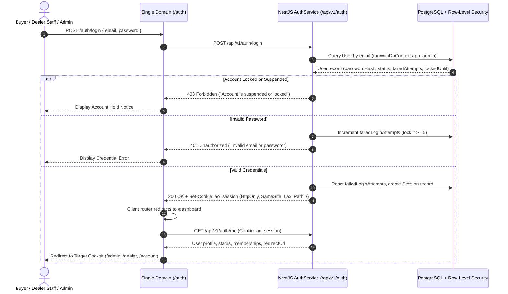

# CF-07: Unified Authentication & Identity Architecture

## 1. Executive Summary

Automotive OS consolidates all platform identity, authentication, session lifecycle, and customer onboarding under a unified architecture. Prior iterations utilized fragmented authentication mocks and disconnected hostnames across marketplace, dealer, and admin applications.

Mission CF-07 establishes:
1. **Single Public Authentication Gateway (`/auth`)**: Eliminates discrete `/login` and `/register` silos, providing an Obsidian Studio Glass tabbed interface for credentials login and customer self-registration.
2. **Customer Self-Registration Constraint**: Public registration is strictly restricted to the `BUYER` role under UAE Federal Law No. 45/2021 (PDPL). Dealership staff, dealer administrators, and platform administrators cannot self-register under any circumstance.
3. **Multi-Tenant Session Cookie (`ao_session`)**: High-entropy JWT delivered via secure, HTTP-only, `SameSite=Lax`, path-scoped (`/`) cookies, authenticated uniformly across marketplace, dealer, admin, and API zones.
4. **Instant Session Revocation**: Backed by a PostgreSQL `Session` ledger, enabling immediate global revocation from the platform admin console or upon security events.
5. **Role-Based Dynamic Resolver (`/dashboard`)**: Evaluates user elevation, tenant memberships, account statuses, and redirects to appropriate operational cockpits.

---

## 2. Authentication Flow & Protocol



---

## 3. Cryptographic Password Hashing Standard

Password storage and verification utilize Node.js native cryptographic scrypt with the following parameters:

```
Format: scrypt$16384$8$1$<hex-salt>$<hex-hash>
- Algorithm: scrypt
- CPU/Memory Cost Parameter (N): 16384 (2^14)
- Block Size Parameter (r): 8
- Parallelization Parameter (p): 1
- Key Length: 64 bytes (512 bits)
- Salt: 16 bytes cryptographically secure random bytes (crypto.randomBytes(16))
- Verification: Constant-time comparison via crypto.timingSafeEqual()
```

### Advantages of Native scrypt:
1. **Zero Native Build Dependencies**: Eliminates `node-gyp`, Python, and C++ compiler prerequisites during Docker builds on Alpine / Debian in Railway.
2. **Side-Channel & Timing Attack Resistance**: Prevents timing attacks via `crypto.timingSafeEqual()`.
3. **Memory Hardness**: High memory cost prevents GPU/ASIC-accelerated brute-force attacks.

---

## 4. Session Token & Cookie Specification

### Cookie Schema:
- **Name**: `ao_session`
- **Path**: `/` (Essential for single-domain routing across `/`, `/dealer`, `/admin`, and `/api`)
- **HttpOnly**: `true` (Inaccessible to client-side JavaScript, mitigating XSS token theft)
- **SameSite**: `Lax` (Prevents CSRF on state-changing requests while supporting standard top-level navigation)
- **Secure**: `true` in production and staging (`NODE_ENV === 'production'`)
- **Max-Age**: `604,800` seconds (7 days)

### JWT Payload Schema:
```typescript
interface JwtSessionPayload {
  sub: string;            // User UUID
  email: string;          // User primary email
  isPlatformAdmin: boolean;// Platform admin elevation flag
  status: UserStatus;     // ACTIVE | SUSPENDED | DISABLED | PENDING_VERIFICATION
  memberships: Array<{
    tenantId: string;     // Dealership UUID
    role: MembershipRole; // OWNER | ADMIN | SALES_MANAGER | etc.
    status: string;       // ACTIVE | SUSPENDED
  }>;
  sessionId: string;      // Backing Session UUID in PostgreSQL
  iat: number;            // Issued-at Unix timestamp
  exp: number;            // Expiration Unix timestamp
}
```

### JWT Extraction Priority:
The NestJS `JwtStrategy` implements dual-mode token extraction:
1. **Cookie Extractor**: Reads `req.cookies['ao_session']` (standard for web browsers).
2. **Bearer Token Extractor**: Reads `Authorization: Bearer <token>` header (standard for automated tests and external API clients).

---

## 5. Instant Session Invalidation

Traditional stateless JWTs cannot be revoked until expiration. Automotive OS pairs JWT issuance with a PostgreSQL `Session` record:

1. When a user logs in, a `Session` record is created:
   ```sql
   INSERT INTO sessions (id, user_id, refresh_token, user_agent, ip_address, expires_at)
   VALUES (uuid_generate_v4(), $1, $2, $3, $4, $5);
   ```
2. When an administrator revokes sessions via `POST /api/v1/admin/users/:id/revoke-sessions`, all active sessions for that user are deleted.
3. Upon `/auth/me` or privileged guard checks, if the `sessionId` in the JWT is no longer active in the database or user status is `SUSPENDED`/`DISABLED`, the request is immediately rejected with `401 Unauthorized` / `403 Forbidden`.

---

## 6. Registration Rules & UAE PDPL Compliance

Under UAE Federal Decree-Law No. 45/2021 on Personal Data Protection (PDPL):
- Registration on `/auth?tab=register` is **customer-only** (`BUYER` role).
- Explicit, affirmative consent is required via checkbox (`consentPdpl: true`).
- The API explicitly filters out any body-injected role elevations (`isPlatformAdmin`, `role`, `tenantId`, `memberships`).
- Customer accounts are initialized with:
  - `status: ACTIVE`
  - `isPlatformAdmin: false`
  - Associated `BuyerProfile` record.
  - Zero tenant memberships.
- Dealership onboarding occurs exclusively via platform admin invitation (`POST /api/v1/admin/dealers`), ensuring strict chain-of-custody for commercial licenses (UAE Trade License / RTA Broker Card).
