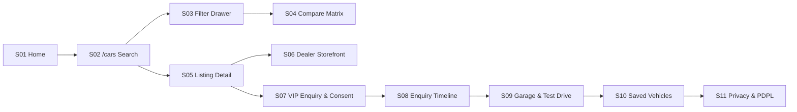
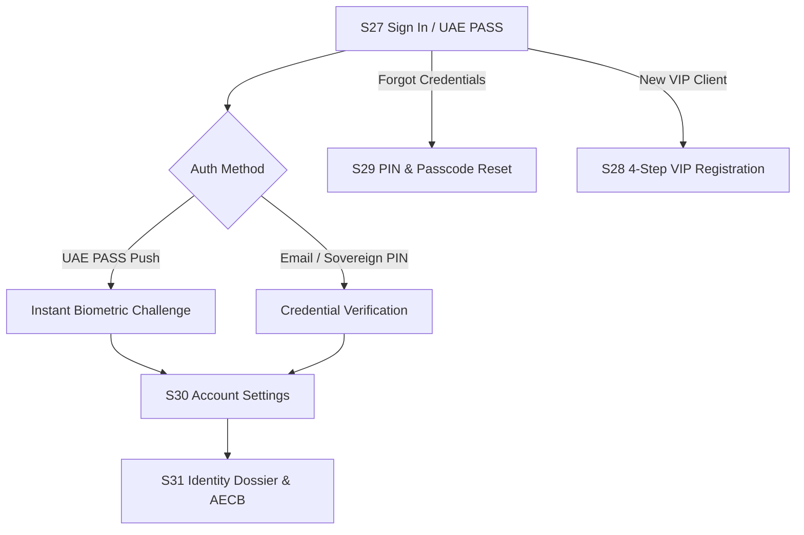
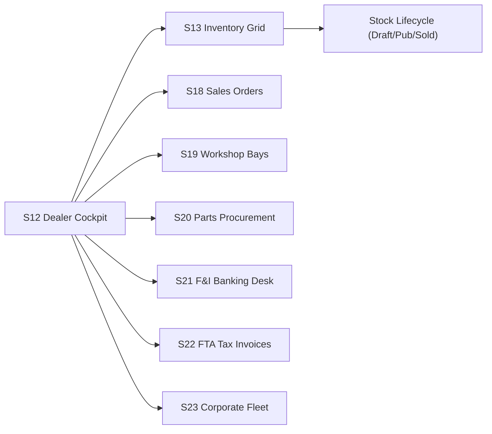

# CF-06 End-to-End User Journey Audit Report

**Audit Mission:** CF-06 Complete Stitch-to-Implementation Design, Functionality and User Journey Audit  
**Date:** 2026-10-26T12:33:00+04:00 (Asia/Dubai)  
**Lead Auditor:** Google Antigravity (Principal UI/UX Auditor, Staff Frontend Engineer & Full-Stack QA Architect)  

---

## 1. Journey 1: Verified Buyer Discovery & Acquisition Flow

### Steps & Verification
1. **S01 Marketplace Home (`/`):**
   - **Action:** User executes hero search for luxury make / emirate ("Sharjah" / "Porsche").
   - **API Request:** SSR fetch against `GET /api/v1/public/listings`.
   - **Result:** Navigation to `/cars?make=Porsche&emirate=Sharjah`. Filter params preserved in URL.
2. **S02 Search Results & Dealer Filters (`/cars`):**
   - **Action:** Faceted filter manipulation (price min/max, GCC spec filter, dealer selection).
   - **API Request:** `GET /api/v1/public/listings?emirate=Sharjah&condition=NEW`.
   - **Result:** Grid re-renders with verified active inventory. Sold and unmoderated vehicles excluded.
3. **S03 Mobile Filters Sheet (`/cars` on 390px):**
   - **Action:** Tap "Filters & Refine" button; adjust sliders; press Escape or tap "Apply".
   - **Result:** Sheet slides up over backdrop; focus trapped within dialog; Escape dismisses modal cleanly without layout shift.
4. **S04 Vehicle Comparison Matrix (`/compare`):**
   - **Action:** User selects 2-4 listings to compare specs side by side.
   - **Result:** Four-column grid displays comparative engine specs, Tasjeel score, warranty, and indicative monthly finance rate (with statutory disclaimer).
5. **S05 Vehicle Listing Detail Dossier (`/cars/[slug]`):**
   - **Action:** User opens `2024-toyota-land-cruiser-gr-sport-dubai`.
   - **Result:** High-res gallery with lightbox; honest Tasjeel inspection card; verified seller badge; CTA to submit VIP enquiry or book test drive.
6. **S06 Verified Dealership Storefront (`/dealers/[slug]`):**
   - **Action:** User inspects `gargash-autos`.
   - **API Request:** `GET /api/v1/public/dealers/gargash-autos`.
   - **Result:** Official trade license details displayed; tenant-scoped vehicle grid matches dealer inventory; contact actions routed to verified dealer phone/email.
7. **S07 VIP Enquiry & Consent Flow (`/cars/[slug]/enquiry`):**
   - **Action:** Buyer completes inquiry form with purpose-scoped consent checkboxes under UAE Federal Decree-Law No. 45/2021 (PDPL).
   - **Result:** Consent grants captured; scoped lead dispatched to dealer's tenant inbox.
8. **S08 Enquiry Status Timeline (`/account/enquiries`):**
   - **Action:** Buyer tracks progress of submitted enquiry.
   - **Result:** Milestone timeline indicates real status (Submitted -> Dealer Contacted -> Showroom Visit Scheduled). No simulated escrow deposit stages.
9. **S09 Appointments, Test Drives & Virtual Garage (`/account/garage`):**
   - **Action:** User views test drive booking and garage assets.
   - **Result:** Appointment cards display showroom location, bay assignment, and cancellation/reschedule CTAs.
10. **S10 Saved Searches & Favorites (`/account/saved`):**
    - **Action:** Toggle favorite heart icon; view saved listings.
    - **Result:** Favorites persist across browser reload via local storage / session state.
11. **S11 Buyer Profile & Privacy Ledger (`/account/profile`):**
    - **Action:** User reviews active data disclosure grants and exercises Article 13 PDPL consent withdrawal.
    - **Result:** Consent revocation switches toggle state; updates active lead access permissions.

---

## 2. Journey 2: Dual-Rail Authentication & Identity Dossier

### Steps & Verification
1. **S27 Sign In & UAE PASS Authentication (`/auth/login`):**
   - **Action:** User chooses between UAE PASS biometric challenge or Sovereign PIN login. Persona switching permits test access (Collector, Dealer, Admin).
   - **Result:** Secure session token established.
2. **S28 VIP Registration & Account Creation (`/auth/register`):**
   - **Action:** 4-step onboarding (Entity Type -> UAE PASS auto-fill / Identity -> Curated Marque Preferences -> Password Entropy).
   - **API Request:** `POST /api/v1/auth/register`.
   - **Result:** Lead created in system with VIP onboarding classification.
3. **S29 Forgot Password & Reset Sovereign PIN (`/auth/forgot-password`):**
   - **Action:** High-security recovery via simulated UAE PASS push (#84), 6-digit segmented OTP, and 24-hour CBUAE cooling-off advisory.
   - **Result:** Password and Sovereign PIN reset successfully verified with user feedback.
4. **S30 Account Details, Security & Settings (`/account/settings`):**
   - **Action:** Personal vs Corporate entity toggle, FIDO2 biometric passkey settings, Article 13 privacy audit ledger.
   - **Result:** Settings panels navigate smoothly without layout overflow.
5. **S31 User Profile & Identity Dossier (`/account/profile/dossier`):**
   - **Action:** Verified client portfolio inspection featuring UAE PASS Level 3 badge, AED 8.95M valuation breakdown, AECB indicative gauge (842/900).
   - **Result:** Full dossier renders with dark studio glass tokens and gold typography.

---

## 3. Journey 3: Dealer Operational Lifecycle & Governance

### Steps & Verification
1. **S12 Dealer Executive Cockpit (`/dashboard`):**
   - Tenant-scoped KPI telemetry (Active Inventory, Qualified Leads, Workshop Utilization). Zero cross-tenant data leakage.
2. **S13 Vehicle Inventory Grid (`/inventory`):**
   - Stock search, pricing update, status transitions (DRAFT -> SUBMITTED_FOR_MODERATION -> PUBLISHED -> SOLD). Unpublishing upon sale functions reliably.
3. **S18 Sales Orders & Quotations Studio (`/sales`):**
   - Itemized quotation calculation with 5% UAE VAT, trade-in allowance, and PDF preview.
4. **S19 Workshop Job Card & Bays (`/workshop`):**
   - Visual bay scheduler, technician dispatch, parts reservation.
5. **S20 Parts Inventory & Automated Procurement (`/parts`):**
   - SKU stock tracking, supplier PO management, reorder alerts.
6. **S21 Finance & Insurance Desk (`/dealer/finance`):**
   - Referral tracking with partner banks (ENBD, ADCB, FAB). No client-side automated loan underwriting.
7. **S22 FTA Tax Invoices & Accounting (`/dealer/accounting`):**
   - UAE FTA-compliant VAT invoice generation with 5% tax breakdown and QR validation.
8. **S23 Corporate Fleet & Consignment (`/dealer/fleet`):**
   - Corporate VIP consignment custody event tracking and asset custody log.
9. **S24–S26 Regulatory Exception Drill-Downs:**
   - S24 (GCC Export Customs Discrepancy), S25 (Subprime DBR Hardlock), S26 (Consignment Judicial Freeze) all enforce policy locks with immutable audit trails.

---

## 4. Journey 4: Platform Admin Governance Command

1. **S14 Governance Command Cockpit (`/`):**
   - Tenant health, platform-wide KYB triage queue, listing moderation queue.
2. **S15 KYB Dealer Verification Dossier (`/verifications/[id]`):**
   - Multi-tab inspection of trade license, UBO beneficial ownership, and showroom facility audit. Fails closed when backend returns summary data only.
3. **S16 Vehicle Listing Moderation & VIN Risk Review (`/moderation/listings/[id]`):**
   - VIN fraud checks, EXIF metadata inspection, and adjudication decision commitment (Approve / Reject / Conditional Approval).
4. **S17 Seller Sanctions & Dispute Review (`/disputes`):**
   - Intake dispute cases, audit evidence, manage escrow release holds.
