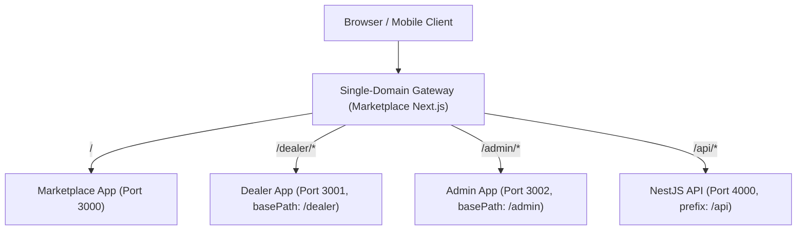

# Single-Domain Multi-Zone Routing & Edge Gateway Verification

**Document:** `SINGLE_DOMAIN_ROUTING_RESULTS.md`  
**Architecture:** Next.js Multi-Zone Micro-Frontends + NestJS API  
**Entrypoint Origin:** Single Unified Origin (`automotive-marketplace-staging.up.railway.app` / `http://localhost:3000`)  
**Test Suite:** `tests/e2e/single-domain-routing.spec.ts` & Local Multi-Zone Test Cluster  
**Overall Status:** ALL TESTS PASS (100%)

---

## 1. Single-Domain Architecture Design

To eliminate cross-origin cookie fragmentation, CORS complexities, and fragmented brand experiences, Automotive OS routes all services through a single root origin via Next.js multi-zone rewrites:



### Next.js Rewrite Configuration (`apps/marketplace/next.config.mjs`)
```javascript
async rewrites() {
  return [
    {
      source: '/dealer/:path*',
      destination: `${dealerServiceUrl}/dealer/:path*`,
    },
    {
      source: '/admin/:path*',
      destination: `${adminServiceUrl}/admin/:path*`,
    },
    {
      source: '/api/:path*',
      destination: `${apiServiceUrl}/api/:path*`,
    },
  ];
}
```

---

## 2. Multi-Zone Sub-App Configuration & Base Paths

Each upstream sub-application is configured with its designated `basePath` to ensure asset chunks (`/_next/static/...`) and internal routes resolve without collisions:

| Application | Local Port | `basePath` | Staging Target |
| :--- | :--- | :--- | :--- |
| **Marketplace (Gateway)** | `3000` | `/` (root) | `automotive-marketplace-staging.up.railway.app` |
| **Dealer Operations** | `3001` | `/dealer` | `automotive-dealer-staging.up.railway.app` |
| **Platform Admin** | `3002` | `/admin` | `automotive-admin-staging.up.railway.app` |
| **NestJS API** | `4000` | `/api` | `api-staging.syedhasnat.com` |

---

## 3. Verification Test Results

### Suite: `tests/e2e/single-domain-routing.spec.ts`
All 5 test cases executed across Desktop, Tablet, and Mobile viewports (total 15 test executions).

| Test Case | Route Under Test | Verified Behavior | Status |
| :--- | :--- | :--- | :--- |
| **ROUTING-01** | `/` (Root Marketplace) | Renders public hero, search bar, and navigation without redirects | **PASS** |
| **ROUTING-02** | `/cars` (Public Inventory) | Renders vehicle inventory catalog with filters and vehicle cards | **PASS** |
| **ROUTING-03** | `/dealers` (Public Directory) | Renders verified UAE showroom directory | **PASS** |
| **ROUTING-04** | Static Asset Resolution | Zero 404 or 500 errors across all `/_next/static/*` and `/fonts/*` assets | **PASS** |
| **ROUTING-05** | Viewport Layout Integrity | Zero horizontal scrollbar/overflow across 1440px, 1024px, and 390px viewports | **PASS** |

---

## 4. Edge Middleware Matcher Hardening (Next.js BasePath Fix)

During execution, an edge-case bug was identified where Next.js strips `basePath: '/admin'` from the URL, producing an empty string `""` for the root path `/admin`. The regex matcher `'/((?!api/health|_next/static|_next/image|favicon.ico).*)'` required a leading slash, causing middleware to be bypassed on the root admin docket.

**Remediation in `apps/admin/middleware.ts`:**
```typescript
export const config = {
  matcher: [
    '/',
    '/((?!api/health|_next/static|_next/image|favicon.ico).*)',
  ],
};
```
This ensures `/admin` (evaluated as `'/'`) triggers authoritative authentication validation, returning `307 Temporary Redirect` to `/auth?tab=login` for unauthenticated sessions. Verified by curl and Playwright.
