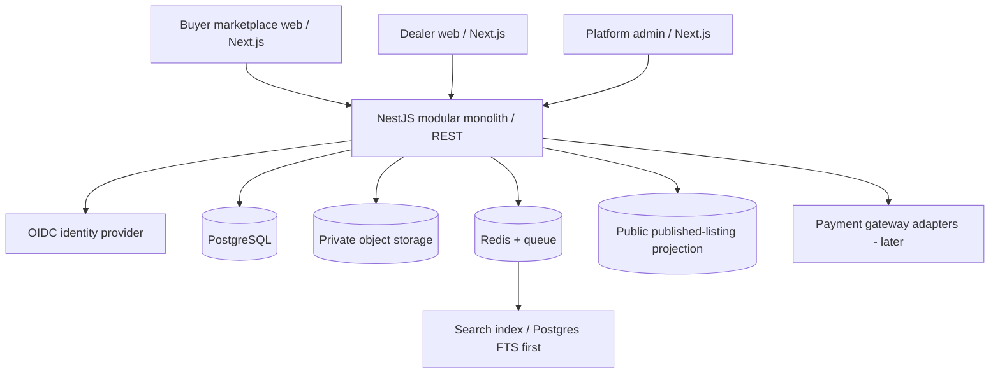

# UAE automotive marketplace + multi-tenant dealership SaaS

Status: **engineering design baseline** (not production-ready code). 20 Oct 2026.

## Scope

Buyer-first UAE marketplace + dealer operations (inventory, listings, leads, appointments) + platform control. Full Keyloop-inspired DMS modules (workshop, parts, sales orders, finance, accounting, fleet) remain on the roadmap and should be added as isolated modules without redesigning identity, stock, listing, and tenant ownership.

## High-level component diagram

**Deployable applications:** `apps/marketplace`, `apps/dealer`, `apps/admin`, `apps/api`. Shared `packages/contracts`, `packages/ui`, `packages/config`. A monorepo is preferred. MVP API is one deployable modular monolith, not microservices.

## Backend domain boundaries

| Module | Owns | Explicitly does NOT own |
|---|---|---|
| identity | OIDC identity links, sessions | dealer roles |
| tenancy | tenants, membership, branches, role checks | buyer-owned profile |
| onboarding | business KYB and reviews | vehicle descriptions |
| catalog | make/model/trim reference data | seller-specific asking prices |
| inventory | VIN, vehicle attributes, cost, stock status, media | published advertising claims |
| marketplace | listing lifecycle, quality, search projection, SEO | physical stock ledger |
| buyers | buyer profile, favorites, saved searches | dealer CRM records |
| crm | leads, consent grants, follow-up, stage changes | global buyer identity |
| appointments | test-drive requests, slots, status | workshop scheduler (later) |
| subscriptions | plan limits, billing provider references | card data custody |
| trust | moderation, reports, suspension workflows | arbitrary unrestricted support access |
| audit-outbox | append-only audit, durable events | business rules |

## Critical data rules

1. Buyer identity is global (`users`, `buyer_profiles`). Dealerships cannot query buyer profiles directly.
2. Dealership data is tenant-owned (`tenants`, `memberships`, `branches`, `vehicles`, `listings`, `leads`, `appointments`), with `tenant_id` on each operational row.
3. Composite foreign keys must prevent a lead in tenant A from referencing tenant B's listing, and a listing from referencing tenant B's vehicle.
4. Buyers can browse **redacted publication data only**. Stock purchase cost, dealer notes, private VINs, buyer phone numbers, internal status histories and grants never appear in public APIs.
5. Dealers may see buyer contact data for *their specific lead* only when an authorized, active, purpose-scoped grant permits that field. Revocations must affect subsequent access.
6. A physical vehicle has one current listing object. `SOLD` / `RESERVED` stock transitions must remove or update public discoverability without relying solely on search indexing.
7. Platform admin is a separate highly restricted and audited authorization surface, not a magical tenant ID.
8. Monetary amounts use **AED fils in integer / BigInt**, with currency code; format in presentation. Avoid JS unsafe-number casts for BigInt values.
9. Store times in UTC; display `Asia/Dubai` for appointments; UAE emirate is explicit.
10. Dealer KYB status, listing quality, subscription eligibility and vehicle availability are mandatory gates before a listing becomes publicly visible.

## Data flows

### Dealer inventory to listing

1. Authenticated dealer user selects a dealer context; API verifies active membership and inventory permission.
2. Create/update private `vehicle` under tenant; images go through signed object-storage upload with inspection.
3. Dealer submits listing for moderation; API validates required images/vehicle attributes, price, status, tenant KYB and subscription limits.
4. Trust reviewer approves the listing, or automatic policy applies if explicitly approved for that seller tier.
5. One DB transaction updates listing status and writes `listing.published` into `outbox_events`.
6. Worker consumes event idempotently and upserts a redacted public projection. Publish gate is still checked against authoritative DB at read time or near real time.
7. Sale/reservation/suspension triggers unpublish/visibility change and projection update.

### Buyer enquiry to scoped CRM

1. Buyer signs in, views a currently published listing, chooses contact fields, and sees a clear disclosure of the specific dealer receiving their data.
2. API checks ownership of buyer identity and verified listing availability.
3. One transaction writes `lead`, `lead_data_grant` (fields, purpose, consent version), `audit_event`, and an outbox event for dealer notification.
4. Dealer accesses the lead only with a valid tenant membership and lead-scoped grant; buyer contact fields not granted are masked.
5. Contact preference, revocation, lead reassignment and retention policy are enforced independently of marketing consent.
6. Appointment service can schedule a test drive against that same tenant lead.

## Security baseline

- OIDC with short-lived access tokens, secure HTTP-only refresh approach, RBAC and fine-grained permissions.
- API resolves verified tenant membership from token subject + tenant ID, never trusts tenant ID from request body as an authorization claim.
- Tenant queries must operate under explicit tenant context and DB RLS using transaction-local setting. Do not use session-level pooled connection settings.
- App database role: `NOSUPERUSER NOBYPASSRLS`; separate non-login migration owner. PostgreSQL `FORCE ROW LEVEL SECURITY` wherever viable. Review privileged workers separately.
- Audit every privileged access, KYB action, price change, listing decision and consent grant/revocation.
- Private object storage buckets, signed URLs, mime sniffing, malware checks, image metadata scrubbing, rate limits and abuse controls.
- Sensitive data encryption, key rotation, backup restore drills, retention policy, DSR/deletion workflows.
- UAE applicable laws, consent wording, seller licensing and finance / insurance claims require specialist legal/compliance review before production.

## Known design gaps before migration

- Establish RLS strategy for `users`, buyer profile, favorites, saved searches, platform operator tables, tenant/KYB, audit/outbox, and public projections. `tenant_policies.sql` is not a complete permission system.
- Add seller listing state transitions and optimistic concurrency / compare-and-swap checks.
- Add specific `LeadIntent` enum, consent version policy, and external contact verification requirements after UX decisions.
- Add canonical manufacturer taxonomy, body type, GCC/non-GCC specs, history/inspection provenance and localized copy as production catalog grows.
- Add full-text public projection + indexing benchmark as stock volume grows.
- Add billing webhook idempotency, payment security, VAT invoicing and e-invoicing implementation after accounting review.

## Technology notes

Avoid tying architecture to transient framework version numbers. Validate specific NestJS, Next.js, Prisma and PostgreSQL compatibility before pinning package versions. Next.js App Router is appropriate for SSR public pages, route-based shells, and client-side interactions. Keep server-only secrets off the browser bundle.
